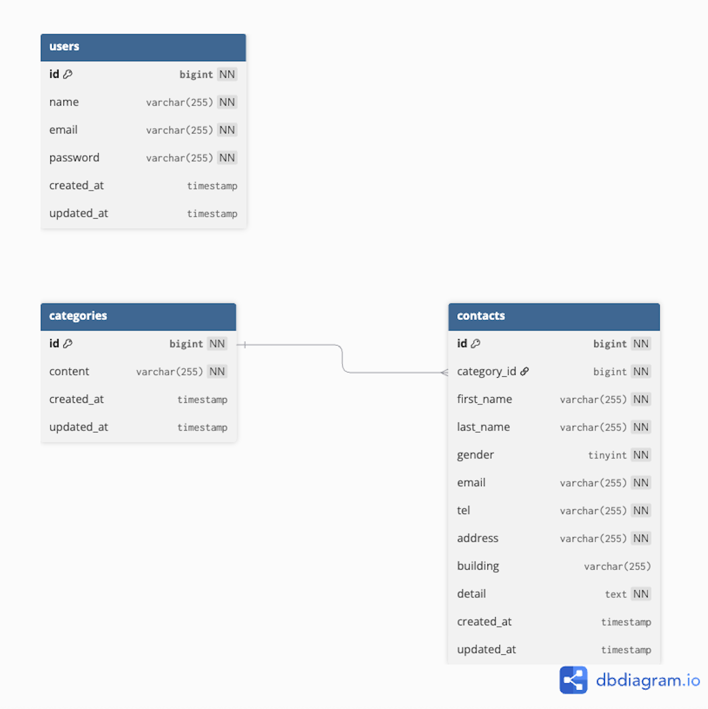

# laravel-docker-template


# アプリケーション名
- contact-form-test

## 環境構築
1. プロジェクトをクローン

$ git clone git@github.com:Estra-Coachtech/laravel-docker-template.git

2.	Dockerイメージをビルドしてコンテナを起動
docker-compose up -d --build

3.	マイグレーションを実行してテーブルを作成
docker-compose exec app php artisan migrate

4.	シーディングでダミーデータを投入
docker-compose exec app php artisan db:seed


## 使用技術(実行環境)
- Laravel 13
- PHP 8.4
- MySQL 8.0
- Docker / Docker Compose
- Fortify（認証用）

## ER図


## ルーティング
| ページ | URL |
|--------|----|
| お問い合わせフォーム入力ページ | / |
| 確認ページ | /confirm |
| サンクスページ | /thanks |
| 管理画面 | /admin |
| ユーザ登録ページ | /register |
| ログインページ | /login |

## テーブル構造
### contactsテーブル
| カラム名 | 型 | 主キー | NOT NULL | 外部キー | 補足 |
|-----------|----|--------|----------|----------|------|
| id | bigint unsigned | ◯ | ◯ | - | - |
| category_id | bigint unsigned | - | ◯ | categories(id) | - |
| first_name | varchar(255) | - | ◯ | - | - |
| last_name | varchar(255) | - | ◯ | - | - |
| gender | tinyint | - | ◯ | - | 1:男性 2:女性 3:その他 |
| email | varchar(255) | - | ◯ | - | - |
| tel | varchar(255) | - | ◯ | - | - |
| address | varchar(255) | - | ◯ | - | - |
| building | varchar(255) | - | - | - | - |
| detail | text | - | ◯ | - | - |
| created_at | timestamp | - | - | - | - |
| updated_at | timestamp | - | - | - | - |

### categoriesテーブル
| カラム名 | 型 | 主キー | NOT NULL | 補足 |
|-----------|----|--------|----------|------|
| id | bigint unsigned | ◯ | ◯ | - |
| content | varchar(255) | - | ◯ | - |
| created_at | timestamp | - | - | - |
| updated_at | timestamp | - | - | - |

### usersテーブル
| カラム名 | 型 | 主キー | NOT NULL | 補足 |
|-----------|----|--------|----------|------|
| id | bigint unsigned | ◯ | ◯ | - |
| name | varchar(255) | - | ◯ | - |
| email | varchar(255) | - | ◯ | - |
| password | varchar(255) | - | ◯ | - |
| created_at | timestamp | - | - | - |
| updated_at | timestamp | - | - | - |

## 機能概要
- お問い合わせフォーム入力・確認・サンクスページ
- バリデーション（フォームリクエスト使用）
  - 入力必須
  - メールアドレス形式チェック
  - 電話番号は数字のみ、5桁まで
  - お問い合わせ内容は120文字以内
- ユーザ登録・ログイン（Fortify使用）
  - バリデーションエラーは各項目下に表示
  - 成功時は管理画面へ遷移
- 管理画面での検索・絞り込み・詳細表示・CSVエクスポート
  - 名前・メールアドレス・性別・お問い合わせ種類・日付で検索
  - 部分一致・完全一致検索
  - ページネーション（7件ごと）
  - リセットボタンで初期状態に戻す
  - モーダルウィンドウで詳細表示・削除
- ダミーデータ生成
  - contacts: 35件
  - categories: 5件
    1. 商品のお届けについて
    2. 商品の交換について
    3. 商品トラブル
    4. ショップへのお問い合わせ
    5. その他
- お問い合わせフォームで入力したデータを表示
  - 姓名の間にスペース
  - 性別は「男性」「女性」「その他」と表示
  - 修正リンクでフォームへ戻り、前回入力値を保持
  - 送信で contacts テーブルに保存、サンクスページへ遷移

## URL
- 開発環境：http://localhost/
- phpMyAdmin: http://localhost:8080/

## バージョンアップと脆弱性チェック

### バージョンアップ（2026年11月）

PHP 8.1 + Laravel 8 から、PHP 8.4 + Laravel 13 に更新しました。
Laravel は公式のアップグレードガイドに沿って 8 → 9 → 10 → 11 → 12 → 13 と1段ずつ上げています。

| 対象 | 変更前 | 変更後 | セキュリティ修正の期限 |
|---|---|---|---|
| PHP | 8.1 | 8.4 | 2028-12-31 |
| Laravel | 8 | 13 | 2028-03-17 |

- 期限の出典: [PHP Supported Versions](https://www.php.net/supported-versions.php) / [Laravel Release Notes](https://laravel.com/docs/13.x/releases)
- `composer audit` で検出された脆弱性は、更新前の59件から0件になりました
- 2026年5月のサプライチェーン攻撃でマルウェア登録された `laravel-lang/lang` は、使っていなかったため依存から削除しました

### 脆弱性チェックの方法

PHP コンテナの中で次のコマンドを実行すると、依存パッケージに既知の脆弱性やマルウェアがないか確認できます（マルウェアの確認には新しい Composer が必要です。2.8 では確認されず、2.11 では確認されることを確かめています）。

```bash
composer audit
```

### 自動チェック

| 仕組み | 内容 |
|---|---|
| GitHub Actions（`.github/workflows/composer-audit.yml`） | `main` への push・PR・毎週月曜に `composer audit` を実行し、問題があれば失敗にする |
| Dependabot（`.github/dependabot.yml`） | composer と Dockerfile の更新を毎週チェックし、更新があれば PR を作る |
